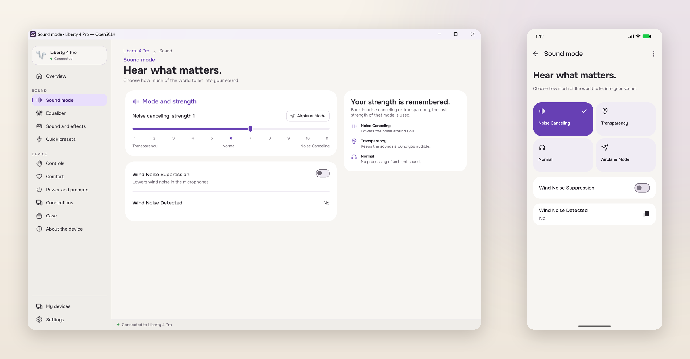
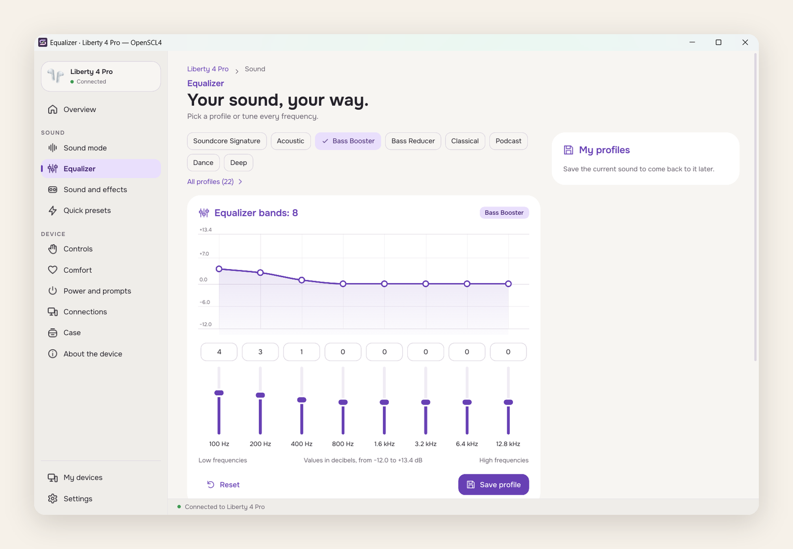

# OpenSCL4

**English** · [Русский](README.ru.md)

OpenSCL4 controls supported Soundcore headphones, earbuds and speakers on Windows, Linux and Android. It is free, open source and works without an account.



_OpenSCL4 1.0.0 on Windows and Android._

[Download 1.0.0](https://github.com/SckraT/OpenSCL4/releases/tag/v1.0.0) · [Install](#install) · [Supported devices](#supported-devices)

## What it does

OpenSCL4 brings the Soundcore settings you use every day into one app.

- **Sound modes.** Noise cancelling, transparency and normal mode, plus mode strength and wind-noise suppression on supported models.
- **Equalizer.** A multi-band equalizer (eight bands on Liberty 4 Pro), Soundcore profiles, your own curves, saved profiles and import/export.
- **Quick presets.** Save a set of device settings and apply it with one click, choosing which settings the preset changes.
- **Device state.** Battery, charging, firmware and serial number when the model reports them.
- **Everyday settings.** Button controls, wearing detection, a second connection (multipoint), LDAC, auto power off and case features.
- **Desktop.** Tray menu, light and dark themes, interface scaling and a layout you can rearrange.
- **Android.** Background connection, notification controls, a home-screen widget, an LDAC quick-settings tile and auto-connect.



_Eight bands, Soundcore profiles and custom curves._

The interface is available in 16 languages, including Russian. Available features depend on the model, firmware and connection state.

## Platforms

| Platform                         | Status    | Packages                       |
| -------------------------------- | --------- | ------------------------------ |
| Windows 10/11 x64                | Supported | Installer, portable `openscl4` |
| Android 8.0+                     | Supported | APK for your phone or tablet   |
| Linux x86_64, Ubuntu 24.04/26.04 | Supported | `.deb`, `.tar.gz`, AppImage    |
| macOS                            | Not yet   | —                              |

## Install

Download the package for your platform from the [OpenSCL4 1.0.0 release](https://github.com/SckraT/OpenSCL4/releases/tag/v1.0.0). `SHA256SUMS` lists the hashes of every attached file.

OpenSCL4 installs alongside OpenSCQ30 and does not import its data.

### Windows

Download **`openscl4-1.0.0-windows-x86_64-setup.exe`** for the per-user installer or **`openscl4-1.0.0-windows-x86_64.exe`** for the portable version. Close OpenSCL4 before installing an update.

The 1.0.0 Windows packages are not signed with an Authenticode certificate, so SmartScreen may show a warning. Check the SHA-256 checksum, then choose **More info → Run anyway** if you trust the download.

### Android

Download the APK that matches your device:

- `openscl4-1.0.0-android-arm64-v8a.apk` — most phones and tablets from the last few years;
- `openscl4-1.0.0-android-armeabi-v7a.apk` — older 32-bit devices;
- `openscl4-1.0.0-android-x86_64.apk` or `openscl4-1.0.0-android-x86.apk` — emulators and x86 tablets.

Android 8.0 or newer is required. Allow your browser or file manager to install unknown apps, open the APK and confirm the installation.

### Linux

Supported on Ubuntu/Kubuntu 24.04 and 26.04 on x86_64.

With the `.deb`:

```sh
sudo apt install ./openscl4_1.0.0_amd64.deb
```

With the archive, install the same runtime dependencies, extract it and run the binary:

```sh
tar -xf openscl4-1.0.0-linux-x86_64.tar.gz
./openscl4-1.0.0/usr/bin/openscl4
```

The AppImage runs without installation:

```sh
chmod +x openscl4-1.0.0-linux-x86_64.AppImage
./openscl4-1.0.0-linux-x86_64.AppImage
```

If FUSE is unavailable, run the AppImage with `--appimage-extract-and-run`. See [Linux installation notes](docs/build-linux.md) for runtime dependencies and Wayland/X11 details.

## First start

1. Pair the headphones, earbuds or speaker in your operating system's Bluetooth settings.
2. Open OpenSCL4, choose **Add device**, select the exact model and then the device paired with the system.
3. If the model is missing from the list, check [Supported devices](#supported-devices) and the [device request guide](docs/request-soundcore-device.md).

## Supported devices

Features depend on the model and firmware. The table lists models with a protocol implementation; a listed model may not expose every setting or support every feature on every platform.

| Model  | Name                         |
| ------ | ---------------------------- |
| A3004  | Soundcore Q20I               |
| A3005  | Soundcore Q11i               |
| A3027  | Soundcore Life Q35           |
| A3028  | Soundcore Q30 / Life Q30     |
| A3029  | Soundcore Life Tune          |
| A3030  | Soundcore Life Tune Pro      |
| A3031  | Soundcore Vortex             |
| A3033  | Soundcore Life 2 Neo         |
| A3035  | Soundcore Space One          |
| A3040  | Soundcore Space Q45          |
| A3062  | Soundcore Space One Pro      |
| A3116  | Soundcore Motion+            |
| A3330  | Soundcore C30i               |
| A3388  | Soundcore AeroClip           |
| A3876  | Soundcore V20i               |
| A3909  | Soundcore Liberty 2 Pro      |
| A3926  | Soundcore Life Dot 2S        |
| A3930  | Soundcore Liberty 2 Pro+     |
| A3931  | Soundcore Life Dot 2 NC      |
| A3933  | Soundcore Life Note 3        |
| A3935  | Soundcore Life A2 NC         |
| A3936  | Soundcore Space A40          |
| A3939  | Soundcore Life P3            |
| A3944  | Soundcore Life P2 Mini       |
| A3945  | Soundcore Life Note 3S       |
| A3947  | Soundcore Liberty 4 NC       |
| A3948  | Soundcore A20i               |
| A3949  | Soundcore P20i / P25i / R50i |
| A3951  | Soundcore Liberty Air 2 Pro  |
| A3952  | Soundcore Liberty 3 Pro      |
| A3953  | Soundcore Liberty 4          |
| A3954  | Soundcore Liberty 4 Pro      |
| A3955  | Soundcore P40i               |
| A3957  | Soundcore Liberty 5          |
| A3959  | Soundcore P30i / R50i NC     |
| A3968  | Soundcore Sport X20          |
| D1101  | Soundcore C50i               |
| D1202  | Soundcore P31i               |
| D1202C | Soundcore R60i NC            |
| D1301  | Soundcore Sleep A30          |

If your model is not listed, search [OpenSCL4 Issues](https://github.com/SckraT/OpenSCL4/issues) and follow the [device request guide](docs/request-soundcore-device.md).

## Data and privacy

OpenSCL4 does not require an account and does not have its own cloud sync. Devices, equalizer profiles, quick presets and app settings stay on your computer or phone.

Uninstalling the Android app removes its local data. Export any equalizer profiles you want to keep first.

## If something does not work

- **The device is not listed.** Make sure it is paired in the system Bluetooth settings, turned on and not connected to another phone or computer. Reopen or refresh the device list in OpenSCL4.
- **A setting is greyed out.** The model, firmware or connection state does not allow changing it. If only one earbud is connected, settings that need both are unavailable.
- **Windows shows a SmartScreen warning.** The 1.0.0 Windows packages do not have an Authenticode signature. Verify the checksum and use **More info → Run anyway** if you trust the download.
- **The Linux window closes instead of hiding.** Hiding needs a registered tray. Without one, closing the window exits.
- **You need to report a bug.** Include the OpenSCL4 version, operating system, device model and steps to reproduce. See [Bluetooth log capture](docs/capture-bluetooth-logs.md) before attaching a capture, and review the log before sharing it.

## Development

The workspace shares device protocols, storage and client rules in Rust. The desktop client uses Slint; the Android client uses Jetpack Compose.

For a desktop development build:

```sh
cargo build --locked -p openscq30-desktop
./target/debug/openscl4
```

See [development and checks](docs/development.md) for architecture, Android builds and tests. Release and packaging details are in [the build and release guide](docs/build-release.md).

## Contributing

Bug reports, feature requests and pull requests belong in [SckraT/OpenSCL4](https://github.com/SckraT/OpenSCL4). Translation updates are welcome as pull requests.

Please keep signing keys, passwords and captured logs with personal data out of commits and public attachments.

## License and credits

OpenSCL4 is licensed under **GPL-3.0-or-later**; see [LICENSE.txt](LICENSE.txt). It is an independent fork of [OpenSCQ30](https://github.com/Oppzippy/OpenSCQ30) by **Kyle Scheuing and contributors**, maintained by SckraT. Original copyright notices and dependency licenses are retained.

Soundcore is a trademark of Anker Innovations. OpenSCL4 is an independent project and is not affiliated with or endorsed by Anker.
