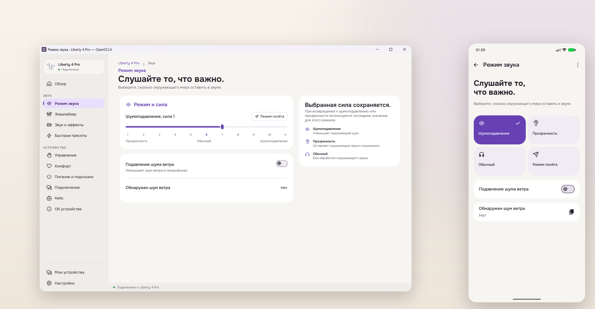
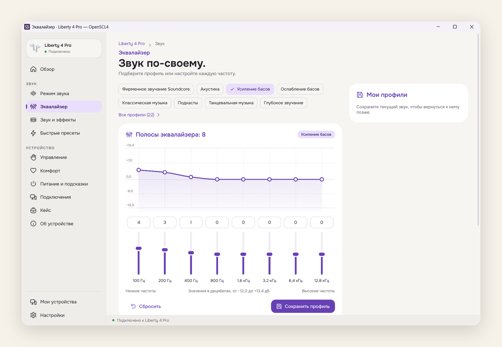

# OpenSCL4

[English](README.md) · **Русский**

OpenSCL4 — приложение для Windows, Linux и Android, которое управляет поддерживаемыми наушниками, вкладышами и колонками Soundcore. Приложение бесплатное, с открытым исходным кодом; аккаунт не нужен.



_OpenSCL4 1.0.0 из опубликованных пакетов, на Windows и Android. Liberty 4 Pro на снимках — демо-устройство; реальные наушники не подключались._

[Скачать 1.0.0](https://github.com/SckraT/OpenSCL4/releases/tag/v1.0.0) · [Установка](#установка) · [Поддерживаемые устройства](#поддерживаемые-устройства) · [Разработка](#разработка)

## Что умеет OpenSCL4

OpenSCL4 — настольный и Android-клиент для настроек, которые устройства Soundcore отдают по Bluetooth. Меняйте режимы и управление, смотрите состояние, которое сообщает само устройство, сохраняйте профили эквалайзера и быстрые пресеты.

- **Режимы звука.** Шумоподавление, прозрачность, обычный режим, а на поддерживаемых моделях — сила текущего режима и подавление шума ветра.
- **Эквалайзер.** Многополосный эквалайзер (восемь полос на Liberty 4 Pro), профили Soundcore, собственные кривые, импорт и экспорт профилей.
- **Быстрые пресеты.** Сохраняйте набор настроек и выбирайте, какие из них применяет пресет: одно нажатие может переключить несколько настроек устройства.
- **Состояние устройства.** Заряд левого и правого наушника и кейса, состояние зарядки, прошивка и серийный номер, а также элементы управления, которые есть у модели.
- **Повседневные настройки.** Действия кнопок, определение ношения, второе подключение (multipoint), LDAC, автовыключение, подсветка кейса и другие параметры конкретных моделей.
- **Удобства на компьютере.** Меню в области уведомлений, закрытие в трей, светлая и тёмная темы, масштаб интерфейса и перестраиваемый главный экран.
- **Интеграция с Android.** Фоновый сервис подключения, управление из уведомления, виджет на главном экране, плитка LDAC в быстрых настройках и автоматическое переподключение.



_Эквалайзер с выбранным профилем Soundcore. Свои профили можно сохранять, импортировать и экспортировать._

Интерфейс переведён на 16 языков, включая русский. Возможности зависят от модели, прошивки и состояния подключения: OpenSCL4 читает значения, которые сообщает устройство, и делает настройку недоступной, если текущее состояние не позволяет её изменить.

## Платформы

OpenSCL4 1.0.0 использует одно ядро на Rust для всех клиентов. Настольный клиент написан на Slint, Android-клиент — на Jetpack Compose.

| Платформа                        | Статус в 1.0.0         | Пакеты                                                           |
| -------------------------------- | ---------------------- | ---------------------------------------------------------------- |
| Windows 10/11 x64                | Поддерживается         | Установщик для текущего пользователя, переносимый `openscl4.exe` |
| Android 8.0+                     | Поддерживается         | APK для `arm64-v8a`, `armeabi-v7a`, `x86_64` или `x86`           |
| Linux x86_64, Ubuntu 24.04/26.04 | Предварительная версия | `.deb`, `.tar.gz`, AppImage                                      |
| macOS                            | Пока нет               | —                                                                |

Linux в этом выпуске — экспериментальная платформа: пакеты и проверки CI есть, но полная матрица сессий GNOME/KDE и проверка на реальных наушниках ещё собирается. Первая цель — Ubuntu/Kubuntu 24.04 и 26.04 на X11 и Wayland.

## Установка

Пакеты опубликованы на [странице выпуска OpenSCL4 1.0.0](https://github.com/SckraT/OpenSCL4/releases/tag/v1.0.0). Скачайте файл для своей платформы и сверьте его с `SHA256SUMS` перед запуском.

> Набор пакетов 1.0.0 опубликован. Если GitHub показывает его как предварительный выпуск, эта метка отражает оставшиеся проверки Linux-сессий и реальных устройств; файлы и контрольные суммы полные.

### Windows

Скачайте **`openscl4-1.0.0-windows-x86_64-setup.exe`** для установки только для текущего пользователя или **`openscl4-1.0.0-windows-x86_64.exe`** для переносимой версии. Перед установкой обновления закройте запущенный OpenSCL4; иначе установщик попросит закрыть его.

Первые пакеты для Windows не подписаны сертификатом Authenticode, поэтому SmartScreen может показать предупреждение. Выбирайте **Подробнее → Выполнить всё равно** только после проверки контрольной суммы SHA-256. Приложение подключается к наушникам через обычный Bluetooth-стек Windows и не устанавливает драйвер.

### Android

Скачайте APK для своего устройства:

- `openscl4-1.0.0-android-arm64-v8a.apk` — большинство телефонов и планшетов последних лет;
- `openscl4-1.0.0-android-armeabi-v7a.apk` — старые 32-битные устройства;
- `openscl4-1.0.0-android-x86_64.apk` или `openscl4-1.0.0-android-x86.apk` — эмуляторы и планшеты на x86.

Нужен Android 8.0 или новее. Разрешите браузеру или файловому менеджеру установку неизвестных приложений, откройте APK и подтвердите установку. Идентификатор приложения — `io.github.sckrat.openscl4`; отладочные сборки используют суффикс `.debug`.

Приложение запрашивает доступ к Bluetooth и устройствам поблизости, а на старых версиях Android — доступ к геолокации для сканирования Bluetooth. Для активного подключения используется фоновый сервис, для управления — уведомления. Разрешение на уведомления позволяет показывать элементы управления в шторке.

OpenSCL4 подписан собственным ключом и устанавливается рядом с OpenSCQ30. Он не импортирует данные OpenSCQ30 и не может обновить установленный OpenSCQ30.

<details>
<summary>Обновление с тестовой сборки 2.x</summary>

Стабильная линейка начинается с Android `versionCode` 1 000 000. Если у вас установлена тестовая сборка 2.x, экспортируйте нужные профили эквалайзера, удалите тестовую сборку и установите 1.0.0. При удалении локальные данные приложения стираются.

</details>

### Linux (предварительная версия)

Первая цель — Ubuntu/Kubuntu 24.04 и 26.04 на x86_64.

С `.deb`:

```sh
sudo apt install ./openscl4_1.0.0_amd64.deb
```

С архивом установите те же зависимости, распакуйте его и запустите программу:

```sh
tar -xf openscl4-1.0.0-linux-x86_64.tar.gz
./openscl4-1.0.0/usr/bin/openscl4
```

AppImage — однофайловая предварительная версия:

```sh
chmod +x openscl4-1.0.0-linux-x86_64.AppImage
./openscl4-1.0.0-linux-x86_64.AppImage
```

AppImage требует FUSE (или `--appimage-extract-and-run`) и те же системные библиотеки, что и архив. Он не добавляет ярлык в меню и не обновляется сам. Основной Linux-пакет — `.deb`. Зависимости, особенности Wayland/X11 и поведение трея описаны в [заметках по установке и сборке для Linux](docs/build-linux.md).

## Первый запуск

1. Сопрягите наушники, вкладыши или колонку в настройках Bluetooth операционной системы.
2. Откройте OpenSCL4, нажмите **Добавить устройство**, выберите точную модель, затем устройство, сопряжённое с системой.
3. Если модели нет в списке, проверьте [поддерживаемые устройства](#поддерживаемые-устройства) и [инструкцию по добавлению модели](docs/request-soundcore-device.md).
4. Чтобы посмотреть интерфейс без наушников, включите **Демо-режим** после выбора модели. Демо-устройства имитируют состояние устройства и никогда не управляют реальным оборудованием.

Источник истины — само устройство. После изменения OpenSCL4 читает фактическое значение и оставляет прежнее, если устройство отклонило запись или не подтвердило её.

## Поддерживаемые устройства

В таблице — модели, для которых есть реализация протокола в ядре на Rust. Это не гарантирует, что каждая настройка, версия прошивки и платформа проверены на реальном оборудовании. Liberty 4 Pro — основное устройство текущей кроссплатформенной работы; остальные модели из общей кодовой базы по-прежнему доступны.

| Модель | Название                     |
| ------ | ---------------------------- |
| A3004  | Soundcore Q20I               |
| A3005  | Soundcore Q11i               |
| A3027  | Soundcore Life Q35           |
| A3028  | Soundcore Q30 / Life Q30     |
| A3029  | Soundcore Life Tune          |
| A3030  | Soundcore Life Tune Pro      |
| A3031  | Soundcore Vortex             |
| A3033  | Soundcore Life 2 Neo         |
| A3035  | Soundcore Space One          |
| A3040  | Soundcore Space Q45          |
| A3062  | Soundcore Space One Pro      |
| A3116  | Soundcore Motion+            |
| A3330  | Soundcore C30i               |
| A3388  | Soundcore AeroClip           |
| A3876  | Soundcore V20i               |
| A3909  | Soundcore Liberty 2 Pro      |
| A3926  | Soundcore Life Dot 2S        |
| A3930  | Soundcore Liberty 2 Pro+     |
| A3931  | Soundcore Life Dot 2 NC      |
| A3933  | Soundcore Life Note 3        |
| A3935  | Soundcore Life A2 NC         |
| A3936  | Soundcore Space A40          |
| A3939  | Soundcore Life P3            |
| A3944  | Soundcore Life P2 Mini       |
| A3945  | Soundcore Life Note 3S       |
| A3947  | Soundcore Liberty 4 NC       |
| A3948  | Soundcore A20i               |
| A3949  | Soundcore P20i / P25i / R50i |
| A3951  | Soundcore Liberty Air 2 Pro  |
| A3952  | Soundcore Liberty 3 Pro      |
| A3953  | Soundcore Liberty 4          |
| A3954  | Soundcore Liberty 4 Pro      |
| A3955  | Soundcore P40i               |
| A3957  | Soundcore Liberty 5          |
| A3959  | Soundcore P30i / R50i NC     |
| A3968  | Soundcore Sport X20          |
| D1101  | Soundcore C50i               |
| D1202  | Soundcore P31i               |
| D1202C | Soundcore R60i NC            |
| D1301  | Soundcore Sleep A30          |

Если модели нет в списке, поищите в [issues OpenSCL4](https://github.com/SckraT/OpenSCL4/issues) и воспользуйтесь [инструкцией по добавлению модели](docs/request-soundcore-device.md).

## Данные и приватность

OpenSCL4 не требует аккаунта и не имеет собственной облачной синхронизации. Устройства, профили эквалайзера, быстрые пресеты и настройки приложения хранятся локально:

- **Windows:** `%APPDATA%\openscl4` (переменная `OPENSCL4_CONFIG_DIR` переопределяет путь);
- **Linux:** `~/.config/openscl4`;
- **Android:** приватное хранилище приложения.

При удалении Android-приложения его данные стираются. Сначала экспортируйте нужные профили эквалайзера. На Windows и Linux перед удалением приложения сохраните каталог данных, если хотите оставить профили и пресеты.

OpenSCL4 устанавливается отдельно от OpenSCQ30 и не импортирует данные OpenSCQ30 автоматически. Магазины, ключи подписи и каналы поддержки исходного проекта не являются каналами распространения или поддержки OpenSCL4.

## Если что-то не работает

- **Устройства нет в списке.** Убедитесь, что оно сопряжено в системных настройках Bluetooth, включено и не подключено к другому телефону или компьютеру. Откройте список сопряжённых устройств в OpenSCL4 заново или обновите его.
- **Настройка недоступна.** Модель, прошивка или текущее состояние подключения не позволяют её изменить. Если подключён только один наушник, настройки, которым нужны оба, недоступны; вставьте второй наушник и дождитесь переподключения.
- **Windows показывает предупреждение SmartScreen.** Пакеты 1.0.0 для Windows не подписаны сертификатом Authenticode. Проверьте контрольную сумму и выберите **Подробнее → Выполнить всё равно**, если доверяете загрузке.
- **Окно Linux закрывается, а не сворачивается.** Для скрытия нужен зарегистрированный трей. В GNOME может понадобиться расширение AppIndicator; без трея закрытие окна завершает приложение.
- **Нужно сообщить об ошибке.** Укажите версию или коммит OpenSCL4, источник пакета, ОС, модель устройства, шаги воспроизведения, а для Linux — окружение рабочего стола и сессию Wayland/X11. Перед прикреплением лога прочитайте [захват Bluetooth-логов](docs/capture-bluetooth-logs.md): в логах могут быть идентификаторы устройства.

## Разработка

Ядро на Rust содержит протоколы устройств, хранилище и общие правила работы клиентов:

| Путь                               | Назначение                                                                   |
| ---------------------------------- | ---------------------------------------------------------------------------- |
| `lib/`                             | Протоколы устройств, API настроек, хранилище SQLite и общие правила клиентов |
| `desktop/`                         | Настольный клиент на Slint; исполняемый файл `openscl4`                      |
| `android/`                         | Адаптер Rust/UniFFI и приложение на Kotlin/Compose                           |
| `cli/`, `gui/`                     | Сохранённые CLI и старый GUI на libcosmic; это не текущий настольный выпуск  |
| `scripts/release.py`, `packaging/` | Общая точка входа для выпуска и платформенные пакеты                         |

Сборка настольного клиента для разработки:

```sh
cargo build --locked -p openscq30-desktop
./target/debug/openscl4
```

Для Android откройте `android/` в Android Studio или соберите одну ABI командой `./gradlew assembleArm64-v8aDebug`. Текущие проверки:

```sh
cargo test --locked -p openscq30-lib -p openscq30-desktop -p openscq30-android
cargo clippy --locked -p openscq30-lib -p openscq30-desktop -p openscq30-android --all-targets -- -D warnings
cargo fmt --all --check
python3 -m unittest discover -s scripts/tests -v
```

Архитектура, интерфейс Android, генерация README и CI описаны в [документации по разработке](docs/development.md). Сборка и выпуск — в [общем руководстве](docs/build-release.md), отдельные руководства: [Windows](docs/build-windows.md), [Android](docs/build-android.md), [Linux](docs/build-linux.md).

## Участие в проекте

Сообщения об ошибках, предложения и pull request'ы — в [SckraT/OpenSCL4](https://github.com/SckraT/OpenSCL4). Переводы присылайте pull request'ами сюда; форк не подключён к сервису переводов исходного проекта.

Не коммитьте ключи подписи, пароли, резервные копии ключей и логи с личными данными. Если меняете протокол устройства, по возможности приложите модель, прошивку и безопасный лог или захват.

## Лицензия и благодарности

OpenSCL4 распространяется по лицензии **GPL-3.0-or-later**; см. [LICENSE.txt](LICENSE.txt). Это независимый форк [OpenSCQ30](https://github.com/Oppzippy/OpenSCQ30), созданный **Кайлом Шойингом (Kyle Scheuing) и участниками проекта**; форк поддерживает SckraT. Исходные уведомления об авторских правах и лицензии зависимостей сохранены. Встроенный шрифт Onest распространяется по SIL Open Font License.

Soundcore — товарный знак Anker Innovations. OpenSCL4 — независимый проект, не связанный с Anker и не одобренный компанией.
